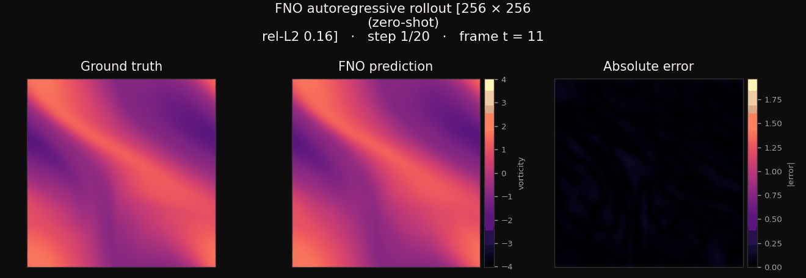

When we started this project, we found that most information about operator learning was quite abstract and difficult to connect to an actual implementation. We wanted to understand the mathematical foundations of Fourier neural operators (FNOs) well enough to build one from scratch and then also learn how to apply it to a real problem.

We also wrote a **[full report (PDF)](../assets/3-fno/report_draft_v3.pdf)** that aims to build intuition around the underlying theory, from operators and kernels to our implementation and results. Essentially, we wanted to write the resource that we would have liked to have when we were getting started to get off the ground more quickly. The code is also available on **[GitHub](https://github.com/CAIS-RnD/operator_fluid_dynamics)**.

If it feels a bit much to read through the full report, this newsletter is meant to serve as a high-level overview. We walk through why standard neural networks struggle with continuous fields, how a few simple mathematical symmetries make the problem much more intuitive, and what we found when comparing our model to a numerical solver.

---

## Predicting continuous fields

Many engineering problems involve predicting fields across space, such as temperature distributions, structural deformation, or fluid motion. Numerical solvers calculate how these change over time by dividing space into a grid and taking small steps forward in time. However, to keep the simulation stable and prevent errors from blowing up, solvers have to take very small steps. Repeating this for different designs or initial conditions can quickly become expensive.

Instead, a trained surrogate model (like an FNO) offers an alternative approach with the aim of speeding up this process. First, we can use a solver to generate example data, train a network to learn how the system behaves (the underlying dynamics), and then reuse that model for faster predictions.

The problem we applied this to was 2D fluid dynamics (under the Navier-Stokes equations). Specifically, the goal was predicting the evolution (20 time-steps) of vorticity, which is a scalar field describing how much the fluid rotates at each point.

{#fig-forecast width=100% fig-align="center"}

The first challenge one is faced with when trying to solve this problem is how to represent a fluid state in a neural network. 

On a $64 \times 64$ grid, we have 4,096 numbers describing the state. The most straightforward approach is to place those numbers into a vector and feed them into a standard Multi-Layer Perceptron (MLP). But this approach has two main issues:

1. **Lost spatial geometry:** Flattening the field into a vector ignores (and removes) spatial relationships. This means that points that sit next to each other in the fluid can end up far apart in a 1D vector. In other words, the network does not automatically know that pixel $(1, 64)$ is right next to pixel $(2, 64)$.
2. **Resolution lock-in:** An MLP is fundamentally tied to the number of input nodes. If you train on 4,096 numbers and then want to evaluate the same fluid on a finer $256 \times 256$ grid (65,536 values), the matrix multiplications do not match in size. (So this is just an impossibility, not a matter of accuracy.)

You might have heard of Convolutional neural networks (CNNs) before (especially if you have read our previous newsletter!) and it is quite intuitive that they can handle spatial relationships much better than traditional MLPs. However, standard CNN filters are tied to pixel steps rather than physical distances, and their receptive fields are local, meaning that they focus on a small area at a time. In a fluid, what happens at one side of the domain affects the other side. So, in essence this means that it is not very natural for a CNN to connect distant points and their interaction (this is the theory of priors).

The core issue is that a fluid is not really a list of numbers but is actually a continuous field, and the grid that we give a network is just where we happened to measure that field.

---

## From vectors to operators

A field can be thought of as a function in 3D space that looks like a surface with hills and valleys. This means that to build a model that is not tied to one grid resolution and can model fields, we need a mapping that takes an entire function as input and outputs a function. In mathematics, a mapping between functions is called an **operator**.

Differentiation ($\frac{d}{dx}$) is a familiar example of a linear operator: you feed in a function like $f(x) = x^2$, and it returns another function, $f'(x) = 2x$. 

When we try to solve this problem we do something similar conceptually but now we take an initial fluid field and map it to a fluid field at a future time. That mapping is a *solution operator*. 

This would mean that if we can train a neural network to approximate this underlying operator (relatively well), the model becomes **grid-independent**. We can train it on whichever grid resolution is fast to simulate, and then evaluate it on a different grid without changing the network weights. 

Essentially, we try to learn the underlying physics so that we can look at the function anywhere, as it is continuous, and not just at the points we happened to sample it.

---

## Kernels and symmetries

The idea of learning a mapping between functions can sound abstract at first. How do you actually design a neural network layer that acts on a continuous function instead of a discrete vector?

In a standard linear layer, the output at a given point is a weighted sum over all input points, using a weight matrix $W$. To turn this into a continuous operation, we can replace the matrix with an **integral kernel** which basically is a function $K(x, y)$ that describes the weight connecting input position $y$ to output position $x$:

$$(\mathcal{K}v)(x) = \int K(x, y) \, v(y) \, dy$$

In an ordinary neural network, it has to learn a separate weight for every connection in a matrix. However, if you have an infinite number of continuous points, that would mean learning an infinite number of weights! But what if we can use symmetric properties from the actual physics of the field...

### 1. Relative displacement and convolution

In a fluid, the physical interaction between two points typically depends on their relative displacement, i.e., how far apart they are and in what direction. That is, the distance between them is more important than their absolute coordinates:

$$K(x, y) = \kappa(x - y)$$

If the weights depend only on displacement, moving the output point simply shifts the weighting pattern across the domain. Applying this same shifted pattern everywhere is exactly what is called **convolution**.

You can think of this as a rule that we slide across the input field, and applying this to each pair of points based on how far apart they are. This means that any point can interact with any other point and the rule changes based on their relative position.

### 2. Why Fourier space speeds this up

A global convolution across $N$ grid points connects every point to every other point. Computing this directly in physical space requires $O(N^2)$ operations, which quickly becomes expensive on finer grids.

This is where Fourier transforms help. Instead of describing the fluid point by point, we can describe it as a sum of sine and cosine waves across the domain. Broad waves describe large flows, while finer waves describe smaller, oscillating variations.

As we show in more detail in the report, convolution preserves frequency. This means that when you apply convolution to a sine wave, the output remains a sine wave with the exact same frequency—only its amplitude (magnitude) and phase (shift) change.

This is the crucial part, because of this property, waves of different frequencies do not mix during convolution:
- We do not need to calculate all pairwise interactions across space.
- We can transform the field into Fourier space with a Fast Fourier Transform (FFT), adjust each wave's amplitude and phase by multiplying with learned complex weights, and transform back with an inverse FFT.
- Using the FFT, the computational cost drops from $O(N^2)$ to **$O(N \log N)$**.

On top of that, in fluid dynamics, most of the field's behavior is captured by the lower-frequency waves that drives the flow. Therefore, we can simply cut off some of the higher frequencies and keep the lowest modes (in our case, the first 12 frequencies along each axis). This keeps the number of learned parameters relatively small while still capturing most of the dynamics of the flow.

---

## Transferring to higher resolutions

Because the learned weights are associated with specific wave frequencies rather than grid indices, they are not tied to the resolution used during training. 

We trained our model on trajectories simulated at **$64 \times 64$**. Once trained, we ran the exact same model weights on a **$256 \times 256$** grid—sixteen times as many points—without any fine-tuning or retraining.

As shown in the animation above, the model produces a good forecast even on the finer grid. The mean per-step error on $256 \times 256$ was close to the error on the coarse grid, even though it had never seen that resolution during training!

This is called zero-shot super-resolution and it is one of the best demonstrations of what operator learning is able to do.

---

## What we learned

While the properties of FNOs sound good in theory, building and profiling the model also gave us a better view of the practical trade-offs compared to traditional numerical solvers:

- **Speed:** On the $64 \times 64$ grid, our FNO was about **5 times faster** than our numerical solver using the largest stable time step we could take. On the $256 \times 256$ grid, the speedup increased to roughly **13 times** (and up to ~80 times when comparing against smaller solver time steps).
- **Batching:** Unlike traditional solvers that usually simulate one trajectory at a time, the neural network processes batches very efficiently. In our test, predicting 8 or 16 trajectories at once gave a substantial throughput gain without much added latency.
- **Accuracy and rollout drift:** The numerical solver was still noticeably more accurate. In our setup, the model predicted 20 steps into the future autoregressively, feeding each output back in as the input for the next step. As time progresses, small per-step errors compound, and the small details in the vorticity field gradually become softer than in the numerical simulation.
- **When it might be useful:** Generating training data and training the network requires compute, and a surrogate model only makes practical sense if you plan to make enough predictions afterward to offset that initial cost, such as in real-time control, interactive design, or large parameter studies. Additionally, when speed is more important than accuracy, the FNO can be a good option. For example, in a real-time control application, you might want to quickly evaluate many different control strategies and then pick the best one to implement.

---

## Conclusion and takeaways

These are some of the key takeaways from exploring the mathematical foundations and implementation of the FNO:

1. **Continuous fields:** When a problem is of a continuous nature or does not have a natural concept of a "pixel", using operator theory avoids having to design the architecture around a specific resolution.
2. **Kernels and convolution:** Because points interact based on their relative distance rather than where they sit in space, we can slide a single "interaction rule" across the whole fluid. This gives every point a direct way to interact with every other point through a global convolution.
3. **Fourier shortcut:** Because convolution preserves wave frequencies, working in the frequency domain makes global interactions much more computationally feasible and also allows filtering out high-frequency noise.
4. **Resolution transfer:** When network weights represent operations on physical frequencies and approximate a field to field mapping, the model naturally generalizes across resolutions.

If you want to explore the mathematical derivations in detail, the numerical solver setup, or our implementation details, you can find them in our **[full report (PDF)](../assets/3-fno/report_draft_v3.pdf)** and the **[GitHub repository](https://github.com/CAIS-RnD/operator_fluid_dynamics)**.

*We thank our partner Aixia for providing the AiQu computing resources used for training.*
