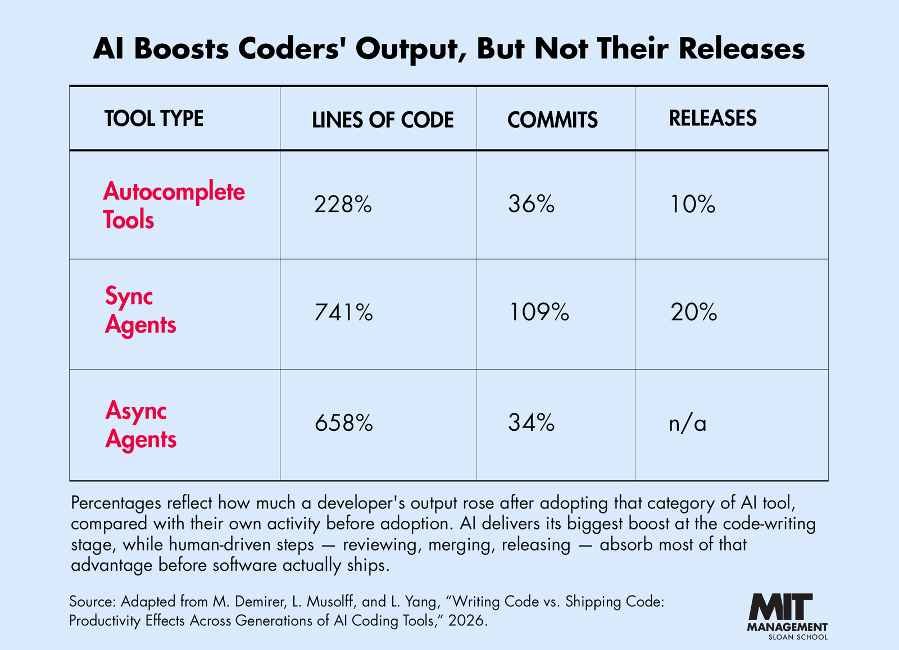

## Introduction

Imagine it's 2016 and you are a senior software developer. Reviewing PRs is a big part of your job but the workload is manageable. The new intern has spent the past two days making a function more efficient and just sent you the PR. The diff is about 120 lines. You review it in 30 minutes and spend the rest of the day writing your own code.

Now imagine it's today. The intern another task and sends a 1000-line PR. Before you even have the time to finish the review the intern sends another PR. It may start to feel a bit overwhelming. 

---

## Productivity does not directly translate to final output

{#fig-output-vs-releases width=100% fig-align="center"}

A joint study from MIT and Wharton [[1]](#references) showed that autocomplete tools boost lines of code by 228% and agents by 741%. That's a lot more code volume, but it only translates to 20% more actual software releases. The productivity was reduced by human bottlenecks such as reviewing changes and launching apps.

The research also observed a broad increase in new apps since 2025. However, there is no corresponding increase in app downloads or reviews. This suggests the surge in productivity is leading to applications with little or no user base. Developers must still test, polish and iterate towards product-market fit, and this part may remain constrained even when you can write code much faster [[2]](#references).

---

## So what is the solution?

There are of course many different ways to approach this, and the best solution depends on your organization and what you are developing. Here are some things you can do.

### Move the rules into the codebase

Store architecture rules, style standards and anti-patterns in repository files such as `AGENTS.md` or `CLAUDE.md`. Update these rules whenever a human catches a recurring AI mistake to avoid repeating errors [[3]](#references).

### Automated tests

Run automated tests in CI/CD and an AI reviewer before human review. This saves time on trivial errors [[4]](#references). The goal is not to remove the human review but to make sure the reviewer spends time on what's important.

### Keep PRs small

Set a cap on PR size of about 500 lines of code, but the ideal size is about 100–200 lines. Large PRs receive slower and lower-quality reviews because reviewers lose focus and the changes are harder to comprehend and reason about.

### Risk-based PRs

Not every PR needs to be reviewed with the same scrutiny. Sort PRs into risk categories where the lowest-risk PRs are auto-approved and high-risk PRs are reviewed line by line.

### Human ownership

Every PR generated by an agent must have an accountable human owner [[5]](#references). A developer who wrote and understands the code takes ownership of maintaining it. Code generated by an agent does not carry the same sense of ownership [[5]](#references).

### Protect build time

People who started as developers for the craft of writing code have lost much of the work they chose to do. Engineers who keep writing code stay fluent enough to catch what the models get wrong. Protect time for hands-on coding for the engineers who review the most code.

---

## References {#references}

1. <https://papers.ssrn.com/sol3/papers.cfm?abstract_id=6843118>
2. <https://mitsloan.mit.edu/ideas-made-to-matter/ai-boosts-worker-productivity-does-translate-to-final-outputs>
3. <https://www.freecodecamp.org/news/how-to-unblock-ai-pr-review-bottleneck-handbook/#heading-two-files-that-changed-everything-agentsmd-and-claudemd>
4. <https://codex.danielvaughan.com/2026/05/24/human-review-bottleneck-code-review-strategies-agent-output/>
5. <https://linearb.io/resources/ai-code-review-bottleneck>
